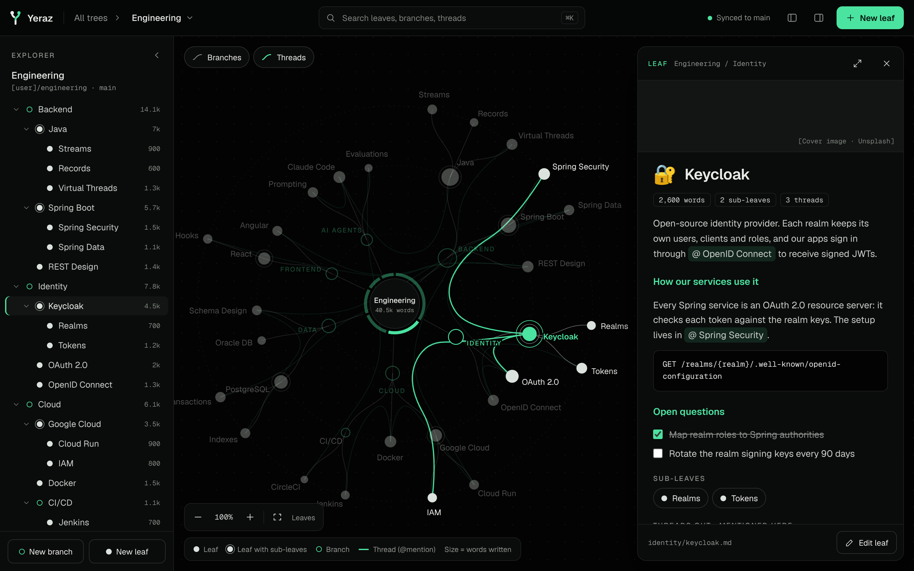

# Design

Everything Yeraz should look like lives in this folder. It is the source of truth for the build: `development-plan.md` §3 and the visual tests point here.



## Links (private to the owner)

- **Design canvas,** where the screens can be explored and clicked through: https://claude.ai/artifact/UWV7RLc2iLsYxB5Sde26c5
- **The conversation** where the design, `ARCHITECTURE.md` and `development-plan.md` were made: https://claude.ai/code/session_01LA2iepBJ3k2JUEstrXEcTD

Both need the owner's login. Everything needed to build the app is copied into this folder.

The canvas also keeps every logo exploration. Three boards of letter marks led to the steel Y (option K), the first logo. Four more boards explored marks without a letter; the vein leaf won and replaced the Y. Its board, *Logo — the leaf*, shows the family, every size and how it is built. The others are there for reference only.

## Screens — `screens/`

Every screenshot is rendered with the real fonts at 2× pixel density (the phone at 3×), so details stay sharp when zoomed.

| File | Shows | Pixels |
|---|---|---|
| `01-home.png` | Home: every Tree on one map, nothing selected | 2880 × 1800 |
| `02-home-tree-selected.png` | Home with a Tree selected: the others dim, a card shows its numbers | 2880 × 1800 |
| `03-tree-view.png` | Tree view: Explorer, map with a leaf selected, Peek panel | 2880 × 1800 |
| `04-leaf-full-page.png` | The Peek expanded into a full page | 2880 × 1800 |
| `05-tree-zoomed-out.png` | Explorer and Peek dismissed, zoomed out to 70 %: leaf labels hidden | 2880 × 1800 |
| `06-map-only.png` | Map only, hovering a leaf, with "Where you write most" | 2880 × 1800 |
| `07-phone.png` | Phone: map zoomed in, Peek as a bottom sheet | 1170 × 2532 |
| `08-app-icon.png` | App icon and logo board: sizes and desktop contexts | 3200 × 3440 |
| `09-appearance.png` | Settings › Appearance in the default theme: base, accent, reading font, custom themes, live preview | 2880 × 1800 |
| `10-appearance-paper-violet.png` | The same screen after picking Paper, violet and the serif font: the whole app re-themes | 2880 × 1800 |
| `11-tree-graphite-blue.png` | Tree view in the Graphite base with the blue accent | 2880 × 1800 |
| `12-tree-paper-green-serif.png` | Tree view in the Paper base with green and the Newsreader reading font | 2880 × 1800 |

Screens 01–08 use the default theme: Vanta base, green accent, Geist.

### Screen sources — `screens/source/`

The canvas file behind each screen (`Main` = Home, `Tree`, `Focus` = map only, `Mobile`, `Logo`, `Themes` = Appearance, `TreeGraphite`, `TreePaper`). Each file is plain HTML plus a small JavaScript class, holding the exact colours, sizes, spacing and copy.

- **`Tree.dc.html` is written entirely with the theme tokens.** It contains no colour values outside its theme block, and switches theme through the same `data-base` / `data-accent` / `data-font` attributes the app will use. `TreeGraphite` and `TreePaper` are the same file with different defaults.

- `Tree.dc.html` holds working reference code for the map: `layoutTree()` (radial layout, bundled threads, the donut around the core) and the selection and dimming rules in `renderVals()`. The real app builds this with d3 (ARCHITECTURE.md §6); use the file to check behaviour and values, not as code to copy.
- Images in these files are referenced as `/_blob/<id>`, the canvas's asset store. They map to the brand files like this:

| `/_blob/` id | File |
|---|---|
| `950463a31529efe511ad57eb7e129d84` | `brand/svg/yeraz-icon.svg` |
| `e633c9d6b60b6fbc3cb27a756cde34a8` | `brand/svg/yeraz-icon-small.svg` |
| `66b516698868b770d203fe97eb9d2f0d` | `brand/svg/yeraz-icon-bleed.svg` |
| `58894e14d6480a5fd47622ef28c29e1e` | `brand/svg/yeraz-mark.svg` |
| `da2e8934360072a51895099b2274886e` | `brand/svg/yeraz-mark-light.svg` |
| `13dd484226652e44a34a092055cbb5bc` | `brand/svg/yeraz-mark-mono.svg` |
| `5e08a8888a5320e635380ff9ad23f9f0` | `brand/svg/yeraz-mark-small.svg` |
| `8823c5adfa9e0febbcc9b44b0b7aec59` | `brand/svg/yeraz-mark-small-light.svg` |

The canvas stores a file under the hash of its content: after `draw.py` changes a master, upload it again and update its id here and in the sources.

## Brand — `brand/`

The logo is a leaf: a note. Its midrib is the note's history, the four dots along it are commits, and the veins are branches. It is brushed steel lit from the upper left, turned 45° so the tip points up and to the right, on a pure black tile. The desktop app's icon is the leaf alone, with no tile (owner's decision): macOS, Windows and Linux draw it over the desktop, and a soft shadow under it keeps it readable on a light one. Phones, the PWA and the favicon keep the tile, since those platforms cut or expect a filled shape. The veins, the midrib and the commit rings are cut clean through, so whatever is behind the mark shows through them. It has no colour of its own, so it sits with every theme and accent. Never tint it or recolour it with CSS; use the files as they are.

| Part | On dark (`yeraz-mark`, icons) | 32 px and below (`-small`) | On light (`-light`) |
|---|---|---|---|
| Left face, facing the light | `#F4F4F2` | `#F7F7F5` | `#7A7A76` |
| Right face, in shade | `#8C8C88` | `#A3A39F` | `#2C2C2A` |
| Stem | `#A9A9A6` | `#B8B8B4` | `#4E4E4B` |
| Commits | `#BEBEBB` | `#CFCFCB` | `#62625F` |

Every part keeps at least 3.6:1 contrast with the top bar it sits on, in every base. The tile is `#000000` with a white hairline edge at 12 % opacity, so it separates from dark wallpapers.

At 32 px and below a bolder drawing takes over: two veins and two commits, thicker cuts, brighter steel. The four-commit leaf would blur there.

### Vector masters — `brand/svg/`

| File | Use |
|---|---|
| `yeraz-icon-desktop.svg` | Desktop app icon master: the leaf alone on a transparent 1024 px canvas, at 900 px |
| `yeraz-icon-desktop-small.svg` | The small drawing alone, for 32 px and smaller |
| `yeraz-icon.svg` | The tile: a 1024 px canvas holding an 824 px rounded tile with a 185 px corner radius (PWA icons) |
| `yeraz-icon-small.svg` | The small drawing on the tile, for 32 px and smaller (the favicon) |
| `yeraz-icon-bleed.svg` | Full-bleed black square for phones and PWA maskable icons. The OS cuts the shape; the tip and the stem stay inside the safe zone. |
| `yeraz-mark.svg` | The leaf without a tile, for the README and anything large |
| `yeraz-mark-light.svg` | The same for light backgrounds, in dark gunmetal |
| `yeraz-mark-small.svg` | The small drawing without a tile: the app's top bar (24 px tall, `public/brand/`) |
| `yeraz-mark-small-light.svg` | The same on the light Paper base |
| `yeraz-mark-mono.svg` | One-colour white, for the macOS menu bar, the Windows tray and one-colour print |
| `favicon.svg` | Browser favicon (the small drawing on the tile) |

All of these are generated by `brand/draw.py`, which holds the leaf's geometry and the shades above. It computes the cut-outs (with shapely), so every file is plain filled paths, with no masks or clips: every browser, icon tool and README renders them the same way. To change the logo, edit `draw.py`, run it, then run `export.py`, and copy the results where the table below says.

### Raster exports — `brand/png/`

Each file is rendered straight from the vector at its exact pixel size, never scaled from another bitmap. 32 px and smaller use the small drawing. The desktop files get their shadow at that size, after rendering.

| File | Goes to |
|---|---|
| `yeraz-icon-{1024…16}.png` | Every desktop size: the leaf alone, no tile |
| `yeraz-app.icns` | `src-tauri/icons/icon.icns` (macOS) |
| `yeraz-app.ico` | `src-tauri/icons/icon.ico` (Windows); 16–256 px, small drawing up to 32 px |
| `pwa-192.png`, `pwa-512.png` | Web app manifest, `"purpose": "any"` |
| `pwa-maskable-192.png`, `pwa-maskable-512.png` | Web app manifest, `"purpose": "maskable"` |
| `apple-touch-icon.png` | iPhone home screen (180 px; iOS rounds the corners) |
| `favicon.ico` | Browser favicon fallback (16, 32, 48 px) |

The web app ships copies of these in `public/`: `favicon.svg`, `favicon.ico`, `icons/` (the PWA and iPhone icons) and `brand/` (the top bar's two small marks). The desktop app's are in `src-tauri/icons/`, named as above, plus `icon.png` (the 512 px icon, Linux), `32x32.png`, `128x128.png` and `128x128@2x.png` (the 256 px icon).

**To regenerate after changing the logo:**

```
pip install shapely cairosvg pillow
python3 design/brand/draw.py     # the SVG masters
python3 design/brand/export.py   # every PNG, ICO and ICNS file
```

Never resize these PNGs by hand, and don't let a tool generate small icon sizes by downscaling the 1024 px file. That is how icons go blurry.

## Themes — `themes/`

| File | What it is |
|---|---|
| `themes.json` | Every colour of every theme: three bases (Vanta, Graphite, Paper), four accents with a dark and a light value each, and the two reading fonts. The app generates its CSS from this file; nothing else in the code may contain a colour. |
| `check.py` | Checks every base and accent combination against the contrast rules: body text 7:1, secondary text, headings and buttons 4.5:1, map dots 3:1. Run it after changing `themes.json`. |

```
python3 design/themes/check.py
```

How themes work, including named colours for leaves and Trees, is described in ARCHITECTURE.md §13.
